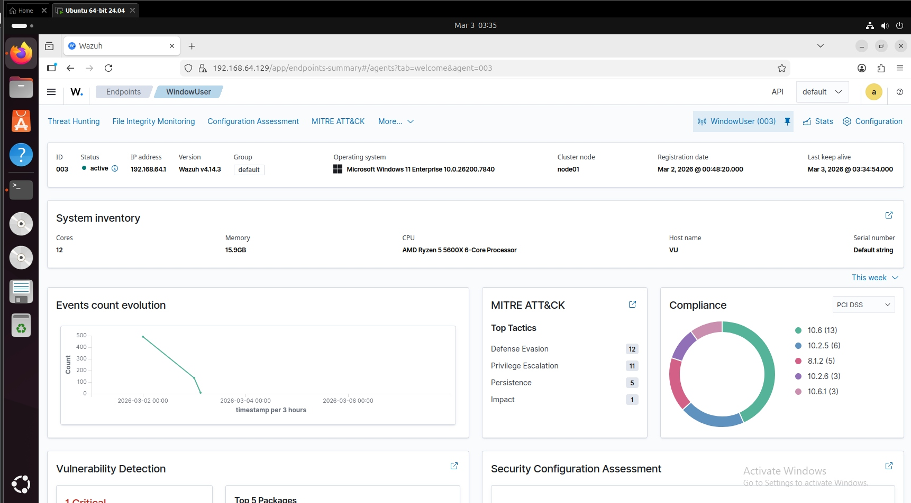
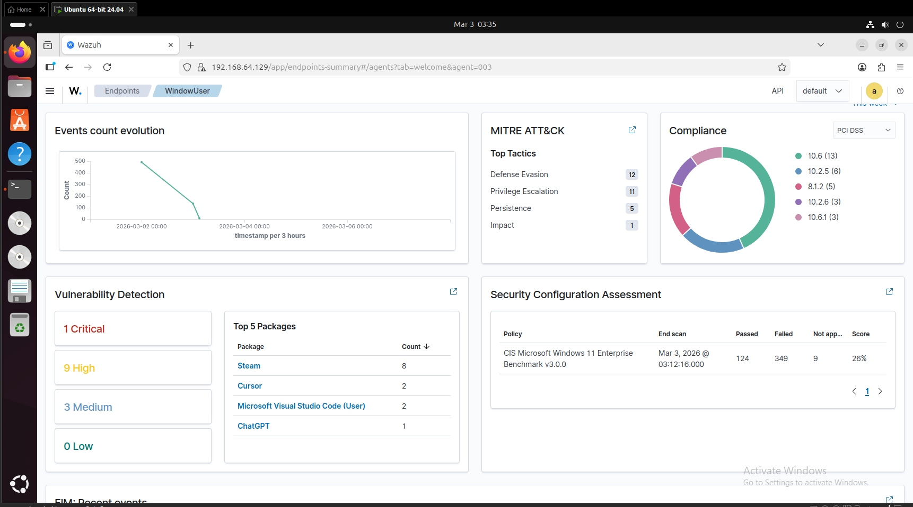
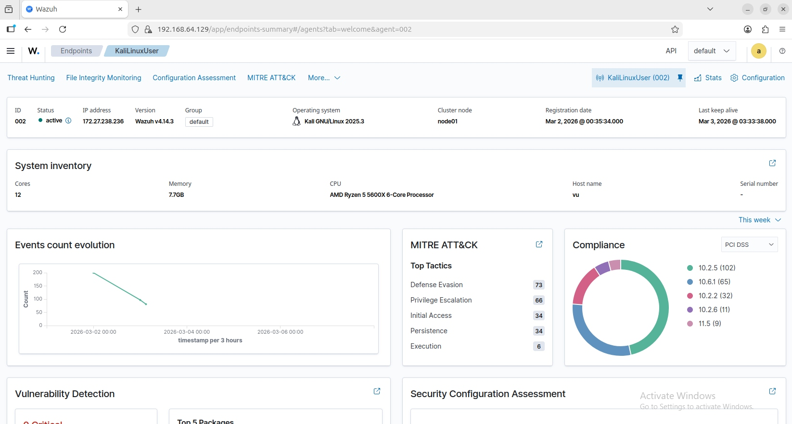
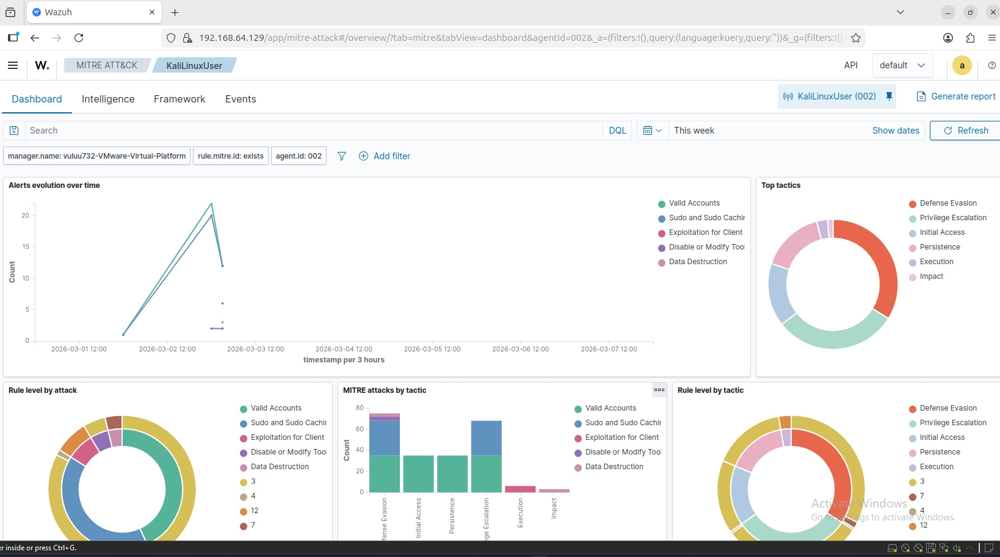
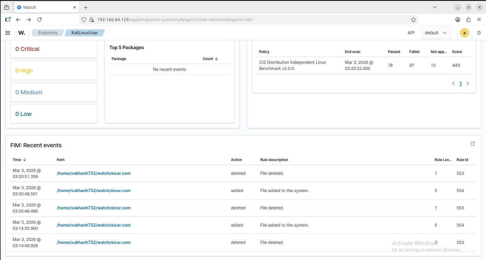

# Wazuh Home SIEM/XDR Homelab (VMware) — Multi-Endpoint SOC Lab + Automated Quarantine

**Owner:** Vu Khanh  
**Stack:** Wazuh (manager + dashboard), Windows endpoint, Ubuntu endpoint, Kali endpoint (WSL2), VMware Workstation networking  

## 1) Project summary
I built a home Security Operations (SOC) lab using Wazuh to ingest endpoint telemetry, perform threat detection and compliance checks, and automate containment actions.  

This lab demonstrates three SOC workflows:
- **Visibility:** onboarding endpoints and verifying data flow end-to-end.
- **Detection & triage:** threat hunting, MITRE ATT&CK mapping, and reviewing file integrity + endpoint events.
- **Response automation:** VirusTotal enrichment + Active Response quarantine to reduce dwell time.

## 2) Architecture (host vs agents)
### Wazuh server (the “SIEM server”)
- Ubuntu VM running the Wazuh manager + dashboard.
- Manager IP: `192.168.64.129` (VMware NAT/VMnet8).

### Agents (endpoints)
- Windows endpoint (`WindowUser`) enrolled as an agent.
- Kali Linux endpoint (`KaliLinuxUser`) enrolled as an agent.
- Ubuntu endpoint (`UbuntuUser`) enrolled as an agent.

Agent enrollment/communication requires reaching the manager on the standard ports (default 1514/1515).  
Docs: https://documentation.wazuh.com/current/user-manual/agent/agent-enrollment/requirements.html

## 3) Evidence (screenshots)

- `agents.png` — Agent inventory + status overview
- `windows_overview.png` — Windows endpoint overview (vulns + CIS + MITRE)
- `windows_details.png` — Windows endpoint details panel
- `kali_overview.png` — Kali endpoint overview
- `mitre_events.png` — MITRE ATT&CK dashboard for Kali events
- `fim_events.png` — FIM recent events showing EICAR added/deleted

### 3.1 Agent inventory


### 3.2 Windows endpoint (vuln + CIS + activity)



### 3.3 Kali endpoint + MITRE ATT&CK



### 3.4 File integrity monitoring (EICAR)


## 4) Key capabilities demonstrated
- **Endpoint onboarding and connectivity validation** (Windows + Linux endpoints).
- **Threat hunting** through centralized event review and MITRE ATT&CK mapping.
- **Vulnerability detection + Security Configuration Assessment (CIS)** to surface hygiene and compliance gaps.
- **File Integrity Monitoring (FIM)** to detect file creation/deletion in realtime directories.

FIM (syscheck) configuration reference: https://documentation.wazuh.com/current/user-manual/reference/ossec-conf/syscheck.html

## 5) Highlight: VirusTotal + Active Response quarantine (end-to-end)
**FIM detects a file → VirusTotal enriches it → Active Response quarantines it automatically.**

### 5.1 Configure FIM (Kali agent)
```bash
sudo mkdir -p /home/vukhanh732/watch /home/vukhanh732/quarantine
sudo chown -R vukhanh732:vukhanh732 /home/vukhanh732/watch /home/vukhanh732/quarantine
```

In `/var/ossec/etc/ossec.conf` on the Kali agent, add to the existing `<syscheck>` block:
```xml
<directories check_all="yes" realtime="yes">/home/vukhanh732/watch</directories>
```

Restart/validate:
```bash
sudo /var/ossec/bin/wazuh-agentd -t
sudo systemctl restart wazuh-agent
```

### 5.2 Enable VirusTotal integration (Wazuh server)
In `/var/ossec/etc/ossec.conf` on the Wazuh server:
```xml
<integration>
  <name>virustotal</name>
  <api_key>YOUR_VIRUSTOTAL_API_KEY</api_key>
  <group>syscheck</group>
  <alert_format>json</alert_format>
</integration>
```

VirusTotal integration docs: https://documentation.wazuh.com/current/user-manual/capabilities/malware-detection/virus-total-integration.html  
`integration` block reference: https://documentation.wazuh.com/current/user-manual/reference/ossec-conf/integration.html

Restart manager:
```bash
sudo systemctl restart wazuh-manager
```

### 5.3 Safe test trigger (EICAR)
```bash
printf 'X5O!P%%@AP[4\\PZX54(P^)7CC)7}$EICAR-STANDARD-ANTIVIRUS-TEST-FILE!$H+H*' > /home/vukhanh732/watch/eicar.com
```

### 5.4 Active Response quarantine
Wazuh Active Response supports custom scripts to execute endpoint actions in response to alerts.

- Script path (Kali agent): `/var/ossec/active-response/bin/quarantine.sh`
- Trigger: VirusTotal malicious alert rule id (example: `87105`)
- Result: file moved from `watch/` to `quarantine/` with a timestamped filename.

Active Response docs:
- How to configure: https://documentation.wazuh.com/current/user-manual/capabilities/active-response/how-to-configure.html
- active-response reference: https://documentation.wazuh.com/current/user-manual/reference/ossec-conf/active-response.html
- Custom scripts: https://documentation.wazuh.com/current/user-manual/capabilities/active-response/custom-active-response-scripts.html

VirusTotal removal PoC (end-to-end workflow): https://documentation.wazuh.com/current/proof-of-concept-guide/detect-remove-malware-virustotal.html

## 6) Resume-ready bullets
- Deployed Wazuh in a VMware homelab, onboarded Windows and Linux endpoints, and validated end-to-end telemetry ingestion and MITRE ATT&CK visibility.
- Implemented realtime file integrity monitoring and VirusTotal enrichment, then automated containment using Wazuh Active Response quarantine on detection.
- Authored a portfolio-quality incident workflow with screenshots, reproducible commands, and troubleshooting notes.
