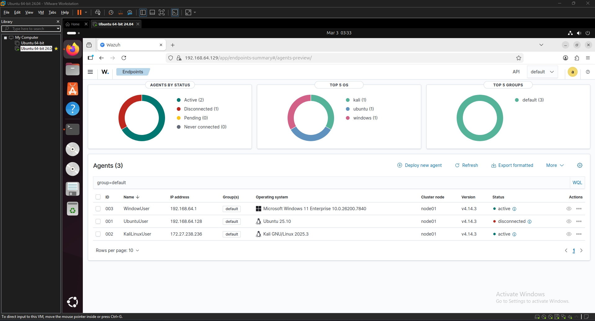

# Wazuh SOC HomeLab

A VMware lab for following endpoint events through detection and investigation. One Wazuh manager monitors Windows, Ubuntu and Kali endpoints, with evidence from agent inventory, MITRE ATT&CK views and file-integrity events.

[Case study](https://security-vu.netlify.app/wazuh.html) · [Lab setup notes](docs/lab-setup.md) · [Offline triage example](examples/triage.sample.md)

## Architecture

```text
Windows ─┐
Ubuntu  ─┼─→ Wazuh manager / indexer / dashboard
Kali    ─┘       → endpoint inventory, FIM, MITRE views
                  → VirusTotal enrichment / lab response configuration

Exported JSONL alerts → Python triage tool → Markdown investigation summary
```

The repo also includes an offline triage tool and a Linux quarantine handler. The handler defaults to a dry run and only accepts the expected VirusTotal alert and watched file path. See the [local demo and install notes](docs/lab-setup.md). It has filesystem tests, but no live Wazuh integration test.

## Evidence from the lab



| Evidence | What it shows |
| --- | --- |
| [Windows overview](evidence/windows_overview.png) / [details](evidence/windows_details.png) | Endpoint inventory, vulnerability and configuration views |
| [Kali overview](evidence/kali_overview.png) / [MITRE events](evidence/mitre_events.png) | Linux telemetry and rule-to-technique mapping |
| [File integrity events](evidence/fim_events.png) | EICAR test-file creation/deletion events |

These are existing lab captures. They do not measure production coverage, response speed or confirmed malicious incidents.

## Summarize an alert export

Python 3.10+, standard library only. The bundled export is synthetic:

```bash
git clone https://github.com/vukhanh732/Wazuh-SOC-HomeLab.git
cd Wazuh-SOC-HomeLab
python3 tools/triage.py examples/alerts.sample.jsonl --min-level 7
```

The [sample report](examples/triage.sample.md) groups alerts by level, endpoint, MITRE technique and rule. To analyze your own JSONL export, run `python3 tools/triage.py /path/to/alerts.json --min-level 10 --agent 003 --output triage.md`.

The export and report are synthetic; the screenshots above are real lab captures. No manager access is needed for the example.

Invalid input stops with a line number and exit code `2`. No report is written after a parsing error.

## Verify

```bash
python3 -m unittest discover -s tests -v
```

Tests cover triage input and quarantine success and rejection paths using temporary files.

## Reproduce the lab

See [lab setup notes](docs/lab-setup.md) for FIM, VirusTotal, a synthetic quarantine dry run and optional live setup. A live lab needs your own Wazuh installation and VirusTotal API key.

The [quarantine message](examples/quarantine-alert.sample.json) is synthetic. Neither tool has been deployed as a live SOC integration.
